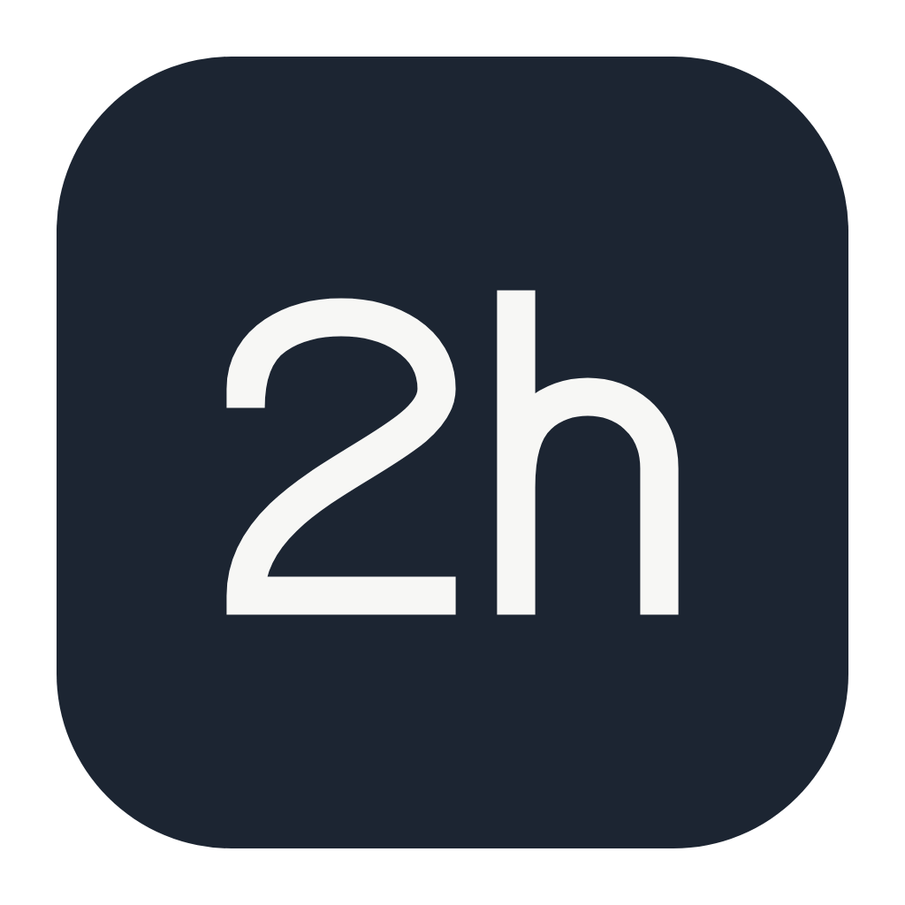
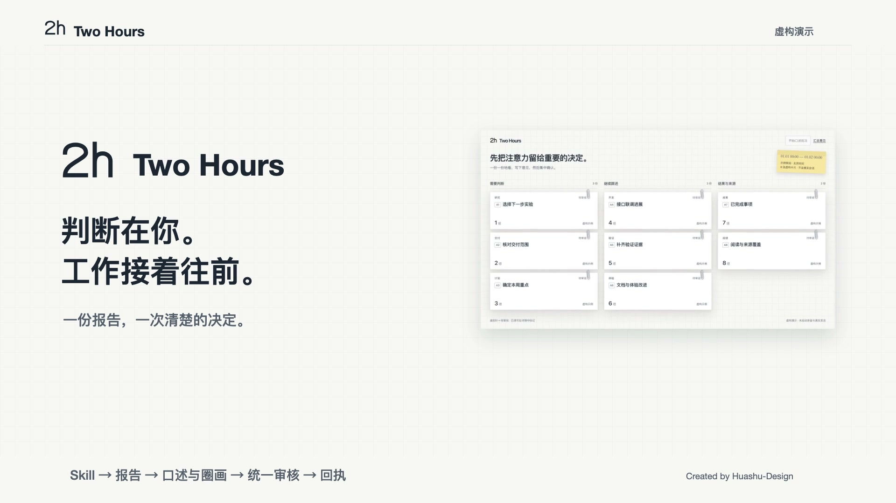

# Two Hours · 2hours


把散落的工作进展和阅读材料放进一份报告，集中审阅、口述圈画，再一次确认任务理解与执行去向。Agent 将独立任务送回各自的 Codex 会话，让工作继续推进。

[](promo/twohours-demo.mp4)

**55 秒演示 · 1080p / 60fps · 含配乐**。沿同一份纸面报告查看证据、口述圈画、核对理解与去向，再一次确认分发。全片使用虚构示例，录制与回执按脚本演示，不含私人会话或真人录音。[制作与重建说明](promo/README.md)。

## 一次审阅

```text
$2hours 回看昨天到现在的 Codex 工作和 Cubox 收藏，生成集中审阅报告。
$2hours 回看上周，准备本周集中审阅。
$2hours 继续 /绝对路径/已有运行目录 中尚未分发的任务。
```

1. Agent 按 Traceink 的证据合同读取工作记录，结合 Cubox 正文，分别呈现工作卡片与逐篇阅读横条。阅读按文章主题只读关联个人知识库中的相关条目，区分文章、已有知识与推断。首屏先随内容和视口调整密度，达到可读下限后分页。详情说明背景、进展、证据边界和下一步，图示保留实际分支、状态条件、角色交接或循环。
2. 点击卡片打开详情。可以写意见，也可以点击「开始口述批注」，选择窗口后边看、边说、边圈画。
3. 完成录制后，Agent 整理原话、截图、AI 理解和目标会话，在 **Two Hours 同一页**呈现统一审核。
4. 修改或暂缓条目，最后确认一次。Agent 使用 Codex 原生工具分发，逐批保存真实回执。

默认范围是昨天；自然周按当地周一至周日计算。录屏不会随报告预览自动启动。发送成功只表示任务已送达，不表示下游工作已完成。

卡片和阅读条目可独立标记「已审阅」，不要求填写文字意见；此标记只保存阅读状态，不批准任务分发。齿轮设置采用左分类、右内容布局，提供录音留存和派发方式，辅助说明可通过信息图标查看。录音默认一直保留，保存策略不会自动删除文件；清理需在逐文件预览后主动执行，未处理或未审核的录音受到保护。范围与到期规则见[设置说明](references/settings.md)。

派发默认仍需在同一页确认一次。用户可主动开启「自动派发」，仅作用于开启后新开始的口述或新提交的文字意见。系统保留原话、材料快照和真实回执，明确的任务直接进入派发，目标不明或理解有疑问的项单独待定。关闭会撤销尚未发送任务的自动授权；重新开启不会追溯授权旧输入。宿主的权限要求仍然适用，程序不会自行向会话发送消息。

## 安装

需要 Python 3.10+、Node.js 20+、uv 和 ffmpeg。macOS 录制要求 macOS 13+ 及 Xcode Command Line Tools。Two Hours 自带录制组件，无需单独安装 Blurt；其他平台未做完整录制验证。

从独立仓库安装一个 Skill 即可，四个组件的源码与所需资源已收入 `vendor/`，无需分别安装四份全局技能：

```bash
# 目标目录已存在时先保留原安装，不要覆盖未提交修改。
git clone https://github.com/WdBlink/2hours.git "${CODEX_HOME:-$HOME/.codex}/skills/2hours"
cd "${CODEX_HOME:-$HOME/.codex}/skills/2hours"

# 使用上游安装器获取固定版本的 Cubox 可执行文件；也可复用 PATH 中已有版本。
node vendor/cubox/cli/scripts/install.js
python3 scripts/run.py doctor
uv run vendor/blurt/scripts/doctor.py
uv run vendor/blurt/scripts/record.py build
```

Cubox 安装器通过 GitHub HTTPS 下载官方 v1.0.10 构建，不需要本机 Go；它不提供额外的校验和检查。源代码同包附带，也可按上游 Makefile 自行编译。首次使用 Cubox 时运行 `vendor/cubox/cli/bin/cubox-cli auth login`；不要把 token 写进聊天或仓库。

重新打开 Codex 会话后调用 `$2hours`。当前宿主需要提供 `list_threads`、`read_thread`、`send_message_to_thread` 和 `create_thread` 等原生工具。缺少工具时仍可生成报告，但不能伪装已分发。

### 首次录制与权限

`doctor` 检查依赖，`build` 编译并安装 `~/Applications/Two Hours.app`。这两个命令不会打开麦克风或采集屏幕。缺少编译器时先运行 `xcode-select --install`。

1. 在报告中点击 **开始口述批注**，按提示选择录制窗口或区域。
2. 在 macOS **系统设置 → 隐私与安全性** 中，为 **Two Hours** 开启 **录屏与系统录音** 和 **麦克风** 权限。系统版本不同，录屏设置名称可能略有差异。
3. 授权后关闭录制窗口，再从报告重新开始。先做一段短录制，确认画面、声音、暂停和完成均正常。

已有 Blurt 权限不能代替 Two Hours 权限，无需卸载 Blurt 或重置系统权限。若构建失败，先修复编译错误；macOS 版不会退回使用 Terminal 或 Codex 的录制权限。不要用旧的 `record.py test` 检验 Two Hours 权限，它测试的是 ffmpeg 的宿主权限。

Two Hours 使用独立的 `~/.2hours/recorder/` 保存录制配置、模型和状态。首次转录需按随包 `doctor.py` 的提示选择 ASR 后端，独立 Blurt 的配置不会自动迁移。页面发起的录制保存在本次运行的 `blurt/` 子目录；已有内容不会被覆盖。

应用标识是 `dev.twohours.recorder`，由 LaunchServices 启动。当前为本机构建与 ad-hoc 签名，并非 Developer ID 公证发行包；权限是否保留由 macOS 决定。

`2h` 标识用于看板、应用和菜单栏，深浅色菜单栏均使用单色模板。[品牌源文件与重建说明](assets/brand/README.md)包含 SVG 和 PNG。终端文字标识沿用 `2h`，当前尚未提供 TUI。

版本更新通过 Git tag 管理：在确认本地改动已保留后 `git fetch --tags`，再切换到选定版本。**唯一维护源是本仓库**，安装目录是运行副本；运行资料独立存于 `~/.2hours/runs/`。

当前发布版为 [`v0.3.2`](https://github.com/WdBlink/2hours/releases/tag/v0.3.2)。已有 Git 安装在保留本地改动后执行 `git fetch --tags` 和 `git switch --detach v0.3.2`。从发布压缩包安装时，将代码解压到新的目录后再替换安装；不要覆盖 `~/.2hours/` 中的运行资料。

## 无私人数据的预览

在仓库目录执行：

```bash
DEMO_RUN=$(mktemp -d)
cp examples/review/* "$DEMO_RUN/"
python3 scripts/run.py render --run "$DEMO_RUN"
python3 scripts/review_bridge.py --run "$DEMO_RUN" --open
```

示例的 8 张卡均为虚构内容，目标表为空。服务只监听 `127.0.0.1`，报告、文字意见和录音保存在本机；使用同源检查和随机 token，没有任意命令接口。普通 `file://` HTML 不具备启动录制或提交审核的能力。

## 验证

```bash
python3 -B -m unittest discover -s tests -v
node --check assets/bridge.js
node --check assets/board.js
node --test vendor/traceink/test/*.test.mjs
```

测试覆盖时间范围、来源映射、实际 AM 图示渲染、看板生成、录制身份、退出分支、统一审核、批准快照和重复派发防护。录制器已通过隔离 HOME 构建；最终品牌版本已从安装目录构建、安装，通过严格签名校验和无采集的 LaunchServices 身份诊断。此检查使用当前 macOS 登录会话，不能证明干净 macOS 用户下的首次权限授予或实际采集；首次使用仍需主动完成上面的短录制检查。

## 边界

这是按需 Skill，尚不是常驻调度器。当前 Codex 回合需等待录音和审核，本地服务需持续运行；结束回合、应用退出或主机休眠后不能保证自动唤醒。定时 loop 应由用户另行配置 Codex 原生 automation。

人工模式下，最终确认同时授权理解结果与目标会话，未选项暂缓；自动模式使用用户明确开启后提交的输入授权，不伪造人工确认。两种模式都绑定来源快照，后续改动进入下一轮，已有发送回执不会自动重放。真实会话、收藏正文、录音、截图和访问凭据不属于本仓库或 release。

## 致谢与源码

| 项目 | 锁定版本 / 提交 | 用途 |
| --- | --- | --- |
| [Blurt](https://github.com/AGIHunt/blurt) | 0.5.0 · `53171c4`；选择性吸收 1.0.2 · `9b4a0e1` | 录屏、口述转录与圈画证据 |
| [Traceink](https://github.com/WdBlink/traceink) | 0.2.0 · `ecadc29` | 会话证据与工作线阅读合同 |
| [Cubox CLI](https://github.com/OLCUBO/cubox-cli) | 1.0.10 · `6eb4e7b` | 收藏与正文读取 |
| [answer-me-with-html](https://github.com/QingYunA/answer-me-with-html) | 0.5.7 · `fa42f5c` | Markdown 排版与 HTML renderer |

四者均按原 MIT 许可集成，各自目录保留完整许可证和 `SOURCE.json`。Blurt 包含 Two Hours 身份与启动方式的本地适配；Traceink 包含本地修订的阅读合同；AM 包含可重建源码、锁文件、renderer bundle 及字体/内嵌依赖许可。报告内容组织也参考了 [ctx-report](https://github.com/motiful/ctx) 的自足上下文思路，不要求配置 CTX。原有版权和许可声明保留。

Two Hours 自有代码自 v0.2.1 起按 [MIT License](LICENSE) 开源；上述第三方组件继续分别适用其原许可证和版权声明。
